# Занковичи

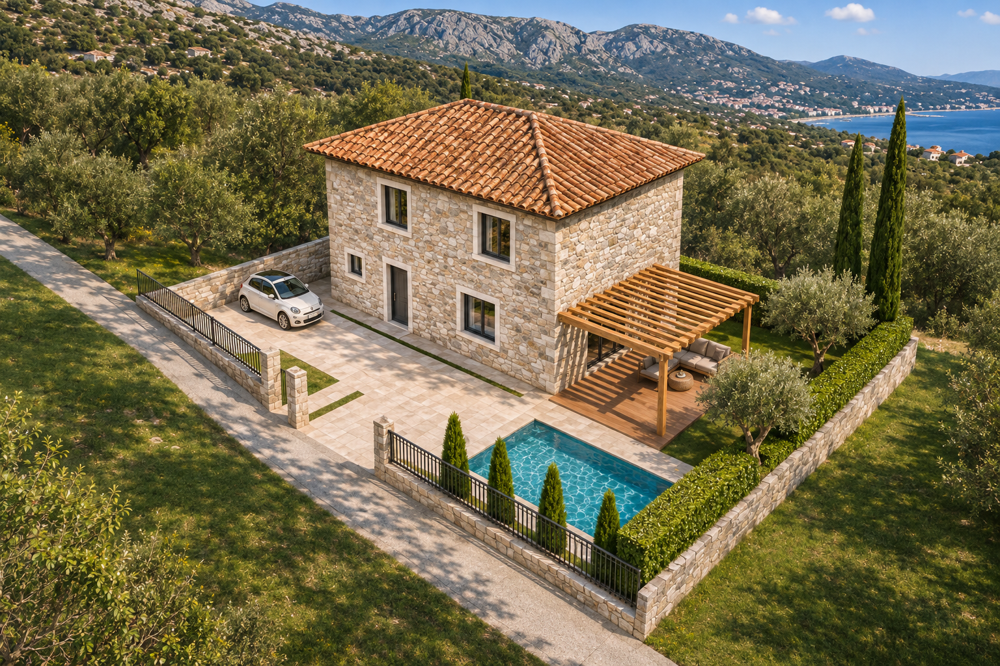

**Реконструкция каменного дома** · Концепция архитектуры и интерьеров

Черногория / Бар · Кадастровый округ Zankovići, участок 1255 · Ноябрь 2026

---

## 01 / Участок — Дом, двор и улица

Въезд находится в нижней части улицы. От ворот проезд идёт вдоль фасада к парковке на западе.

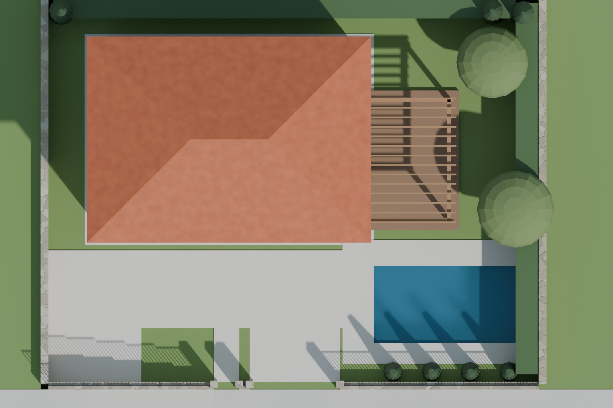

*Вид сверху из Blender. Улица внизу, парковка слева, бассейн справа от дома.*

| | |
|---|---|
| **10 × 7 м** | Габарит дома по наружным стенам |
| **6 × 3 м** | Бассейн · глубина по модели 1,4 м |
| **3,6 × 4,8 м** | Пергола у выхода из кухни-гостиной |
| **0,7 м** | Перепад между двором и улицей у парковки |

Бассейн и пергола образуют зону отдыха у восточной стены. Четыре туи вдоль уличной ограды прикрывают бассейн со стороны проезда.

---

## 02 / Экстерьер — Камень, черепица и дерево

Традиционный силуэт каменного дома дополняют лаконичная ограда и открытая пергола.

| Фасад со стороны улицы | Терраса у бассейна |
|---|---|
| 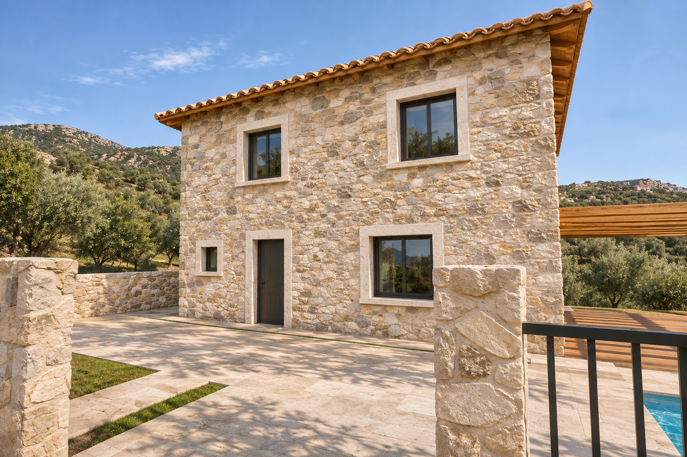 | 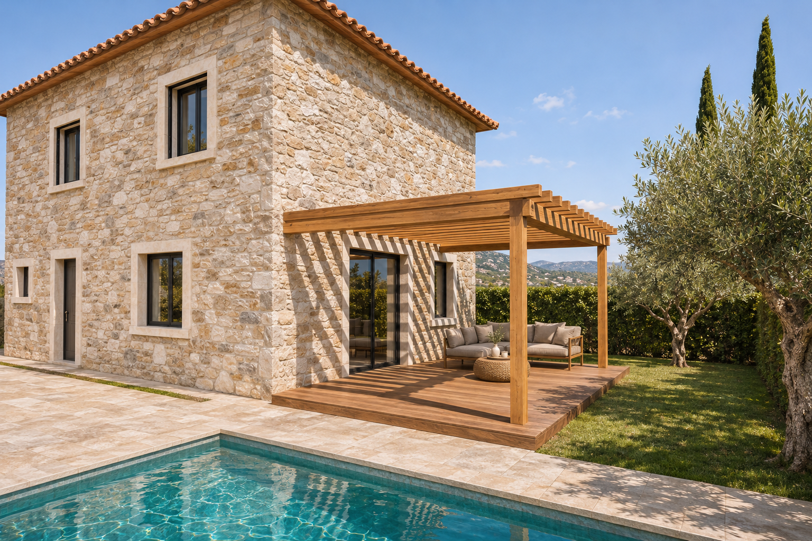 |
| **Известняк.** Светлый камень и известковые швы подчёркивают фактуру кладки. Антрацитовые рамы и ограда собирают рисунок фасада, а терракотовая черепица добавляет тепла. | **Тёплое дерево.** Рейки перголы дают подвижную тень. Деревянный настил выделяет террасу на фоне светлого мощения, а оливы и кипарисы продолжают зелень участка. |

---

## 03 / Планировка — Первый и второй этаж

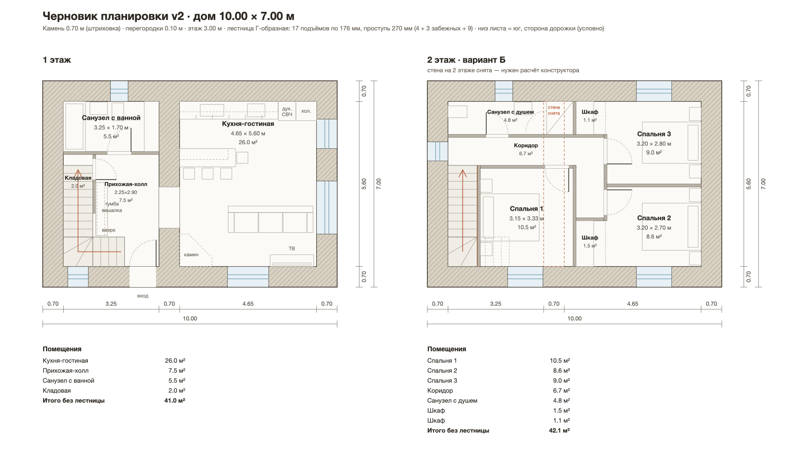

**Первый этаж.** Вход со стороны улицы ведёт в холл с лестницей. Кухня-гостиная выходит на террасу. Кухня и гостиная занимают единый объём. В западной части собраны лестница, кладовая и санузел с ванной. Ширина лестничного марша 1,0 м, 17 подъёмов по 176 мм, глубина проступи 270 мм.

**Второй этаж, вариант Б.** Три спальни, шкафы при спальнях 2 и 3 и узкий санузел с душем в торце. Пунктир показывает положение каменной стены, которую в варианте Б предполагается разобрать. Решение требует расчёта конструктора.

---

## 04 / Интерьер — Гостиная

Общая зона первого этажа · 26,0 м² вместе с кухней

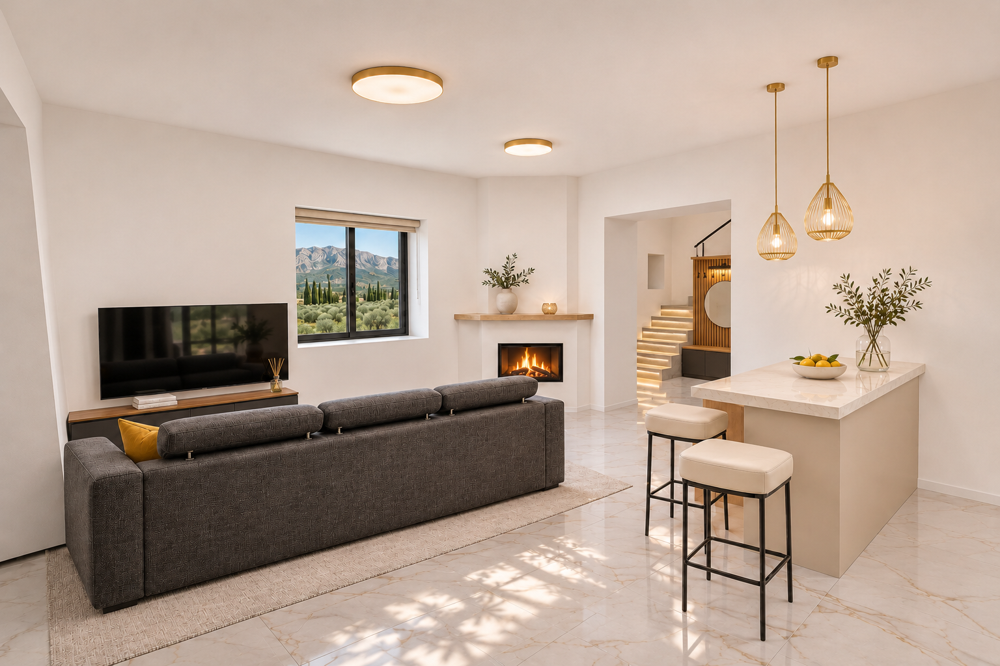

*Вид из кухни на камин, ТВ-зону и проход к лестнице.*

**Светлая основа.** Белые стены и светлый пол с мягкими прожилками отражают дневной свет. Глубокие оконные откосы подчёркивают толщину каменных стен.

**Тёмные акценты.** Антрацитовый диван и рамы создают контраст. Тёплое дерево и приглушённое золото связывают гостиную с кухней и холлом.

Палитра: `#EDE5D8` тёплый белый · `#3F3B36` антрацит · `#AC8656` тёплое дерево

---

## 05 / Интерьер — Кухня и барная стойка

Кухня вдоль глухой стены. Раздвижная дверь ведёт на террасу.

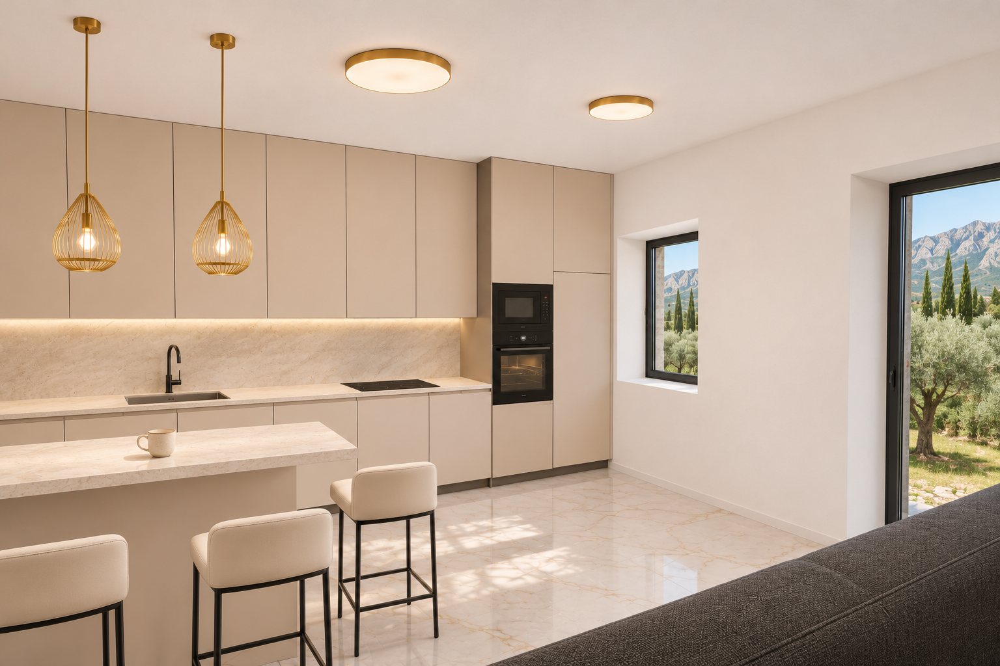

*Встроенная техника и шкафы до потолка образуют спокойный фон для общей комнаты.*

**Кашемир и светлый камень.** Тёплые бежевые фасады без ручек смягчают белую основу. Столешница и фартук в близких тонах объединяют рабочую линию.

**Свет над стойкой.** Золотистые подвесы обозначают зону завтрака. Подсветка под шкафами отдельно освещает рабочую поверхность.

Палитра: `#BFAE96` кашемир · `#E9DFCF` светлый камень · `#B4894D` тёплый металл

---

## 06 / Интерьер — Холл и лестница

Прихожая · 7,5 м². Лестница связывает общую зону и спальни.

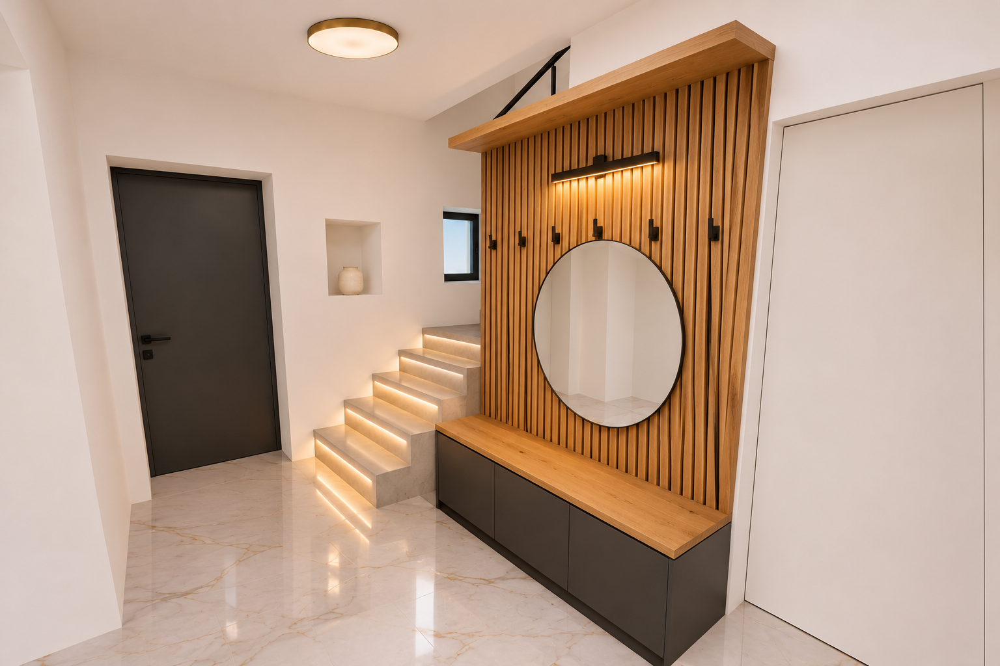

*Дубовая панель с крючками, круглое зеркало и скамья у лестницы.*

**Дуб и графит.** Вертикальные рейки собирают зону хранения в один объём. Тёмная скамья перекликается с перилами, а зеркало ловит свет у входа.

**Линия ступеней.** Светлый бетон и тёплая подсветка под ступенями подчёркивают поворот лестницы. Тонкое чёрное ограждение сохраняет ощущение открытого пространства.

Палитра: `#AB7849` дуб · `#D6CFC1` светлый бетон · `#383634` графит

---

## 07 / Спальни — Олива и терракота

Три спальни объединяют светлые боковые стены, натуральный текстиль и тёплый свет у изголовий.

| Спальня 1 · 10,5 м² | Спальня 2 · 8,6 м² |
|---|---|
| 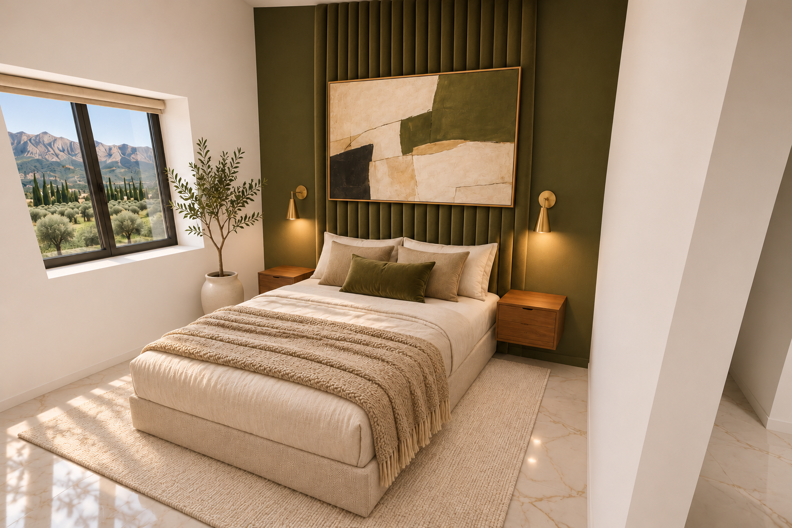 | 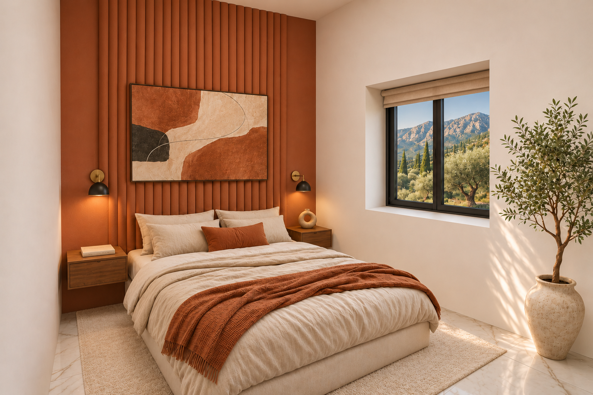 |
| **Глубокая олива.** Приглушённый зелёный повторяет оттенки пейзажа за окном. Тёплое дерево, латунь и кремовый текстиль смягчают тёмную стену. | **Тёплая терракота.** Цвет обожжённой глины отсылает к черепице дома. Вертикальные рейки, картина и льняной текстиль добавляют фактуру в одной тёплой гамме. |

---

## 08 / Спальни — Спальня в дымчато-синем

Спальня 3 · 9,0 м². Кровать 140 см по модели, шкаф встроен в нишу.

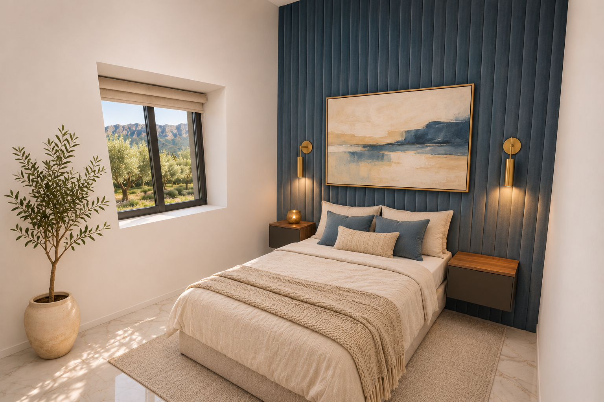

*Акцент за изголовьем и окно в боковой стене.*

**Синий и песочный.** Глубокий приглушённый синий даёт более прохладный характер комнате. Светлый лён, дерево и латунь возвращают тепло.

**Общий мотив.** Панель за изголовьем, парные светильники и картина связывают комнату с двумя другими спальнями. Цвет делает её самостоятельной.

Палитра: `#3C5661` дымчато-синий · `#E7D7BF` лён · `#AA895F` тёплый металл

---

## 09 / Санузлы — Светлый камень и тёмные детали

Крупный формат плитки, прозрачное стекло и тёплый свет объединяют оба санузла.

| Первый этаж · 5,5 м² | Второй этаж · 4,8 м² |
|---|---|
| 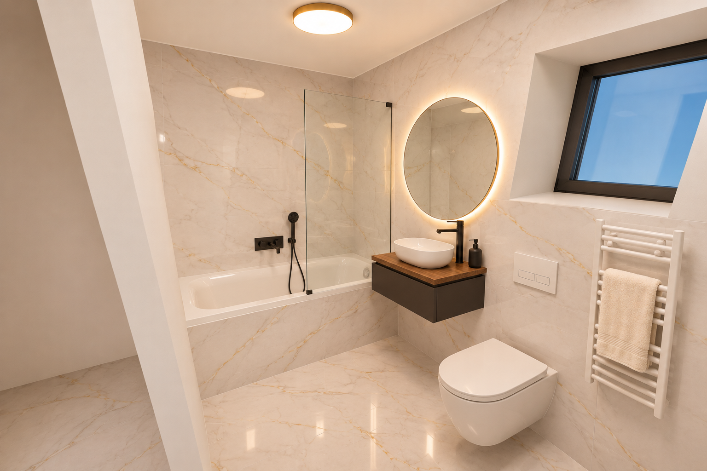 | 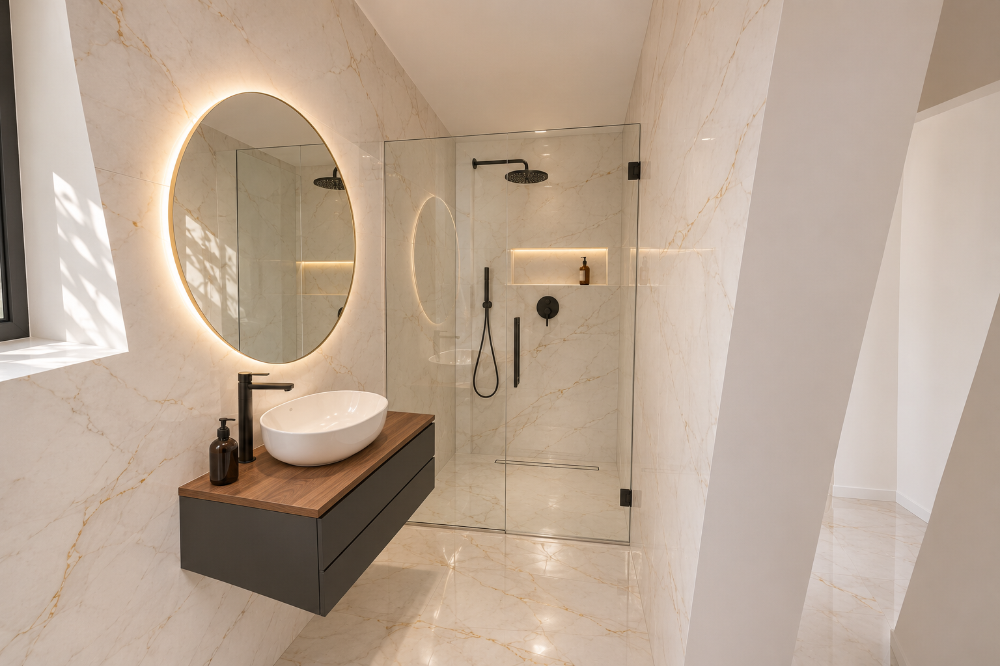 |
| **Ванна.** Ванна стоит в торце. Светлый керамогранит под мрамор объединяет стены и пол, а дерево, чёрная фурнитура и подсветка зеркала добавляют глубины. | **Душ.** Санузел 4,25 × 1,12 м. Душ занимает торец 1,12 × 0,90 м. По плану предусмотрена одна распашная створка 70 см и неподвижная часть остекления. |

---

Все размеры черновые и пока не замерены на месте. Изображения — концептуальные визуализации по модели.

**[Техническая документация →](docs/technical.md)** Как устроен проект, как пересобрать план, модель и кадры.
